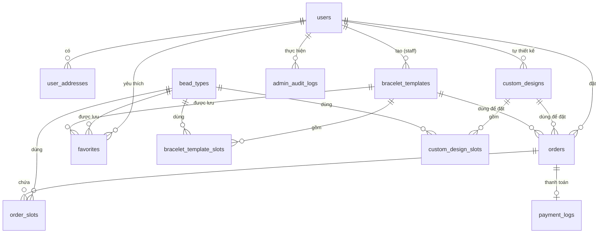

# 📚 TÀI LIỆU CƠ SỞ DỮ LIỆU USCOLLECTION (DATABASE DATA DICTIONARY)

**Dự án**: UsCollection — Ứng dụng E-Commerce Vòng Tay Thủ Công 3D  
**Hệ CSDL đang chạy**: PostgreSQL qua Prisma
**Lưu ý**: Phần sơ đồ và các bảng JSON bên dưới là tài liệu kiến trúc cũ, không còn mô tả database hiện tại. Schema chuẩn nằm trong [`prisma/schema.prisma`](./prisma/schema.prisma) và [`supabase_schema.sql`](./supabase_schema.sql). Các API JSON cũ đã bị tắt; xem [`SUPABASE_SETUP.md`](./SUPABASE_SETUP.md) để khởi tạo database.

---

## 📐 1. SƠ ĐỒ THIẾT KẾ QUAN HỆ (ERD DIAGRAM)



---

## 📑 2. CHI TIẾT 12 BẢNG / COLLECTIONS (DATA DICTIONARY)

### 2.1 Bảng `users` — Tài khoản người dùng
Lưu trữ toàn bộ tài khoản trong hệ thống với phân quyền 3 Role.

| Cột | Kiểu Dữ Liệu | Khóa | Ghi Chú / Mô Tả |
|---|---|---|---|
| `id` | `VARCHAR/UUID` | **PK** | Mã định danh duy nhất người dùng |
| `email` | `VARCHAR` | **UNIQUE** | Email đăng nhập hệ thống |
| `password_hash` | `VARCHAR` | | Mật khẩu đã được mã hóa (Bcrypt / Argon2) |
| `full_name` | `VARCHAR` | | Họ và tên người dùng |
| `phone` | `VARCHAR` | | Số điện thoại liên hệ |
| `avatar_url` | `VARCHAR` | NULL | Ảnh đại diện (nếu có) |
| `role` | `ENUM` | | Phân quyền: `customer`, `staff`, `admin` |
| `status` | `ENUM` | | Trạng thái: `active`, `locked` |
| `last_login_at` | `TIMESTAMP` | NULL | Thời điểm đăng nhập gần nhất |
| `created_at` / `updated_at` | `TIMESTAMP` | | Ngày tạo và ngày cập nhật bản ghi |

---

### 2.2 Bảng `user_addresses` — Sổ địa chỉ giao hàng
Lưu trữ các địa chỉ nhận hàng của người dùng.

| Cột | Kiểu Dữ Liệu | Khóa | Ghi Chú / Mô Tả |
|---|---|---|---|
| `id` | `VARCHAR/UUID` | **PK** | Mã địa chỉ |
| `user_id` | `VARCHAR/UUID` | **FK → users`** | Thuộc sở hữu của người dùng nào |
| `recipient_name` | `VARCHAR` | | Tên người nhận hàng |
| `phone` | `VARCHAR` | | SĐT nhận hàng |
| `address_line` | `TEXT` | | Số nhà, tên đường, phường/xã |
| `province` | `VARCHAR` | | Tỉnh / Thành phố |
| `is_default` | `BOOLEAN` | | Đặt làm địa chỉ mặc định (`true`/`false`) |
| `created_at` | `TIMESTAMP` | | Thời điểm tạo |

---

### 2.3 Bảng `bead_types` — Catalog hạt 3D & Kho hàng
Quản lý các loại hạt 3D, giá bán, giá vốn và tồn kho.

| Cột | Kiểu Dữ Liệu | Khóa | Ghi Chú / Mô Tả |
|---|---|---|---|
| `id` | `VARCHAR` | **PK** | Slug nhận diện (ví dụ: `rose-quartz`) |
| `code` | `VARCHAR` | **UNIQUE** | Mã hạt quản lý kho (ví dụ: `BEAD-RQ-01`) |
| `name` | `VARCHAR` | | Tên hiển thị của hạt |
| `material` | `ENUM` | | Chất liệu: `crystal`, `glass`, `wood`, `stone`, `pearl` |
| `color_hex` | `VARCHAR` | | Mã màu Hex 3D render (`#F4A7B9`) |
| `emissive_hex` | `VARCHAR` | NULL | Mã màu phát sáng 3D (nếu có) |
| `metalness` | `FLOAT` | | Độ kim loại (0.0 – 1.0) |
| `roughness` | `FLOAT` | | Độ nhám bề mặt (0.0 – 1.0) |
| `description` | `TEXT` | | Mô tả công dụng & phong thủy của hạt |
| `cost_price` | `INT` | | **Giá vốn** (để tính báo cáo lợi nhuận) |
| `sell_price` | `INT` | | **Giá bán** niêm yết |
| `stock_quantity` | `INT` | | Số lượng tồn kho còn lại |
| `is_active` | `BOOLEAN` | | Trạng thái hiển thị (`true`/`false`) |
| `diameter` | `INT` | | Đường kính hạt (mm) |

---

### 2.4 Bảng `bracelet_templates` — Mẫu vòng tay có sẵn
Danh sách các mẫu vòng tay thiết kế sẵn do nhân viên hoặc admin tạo và xuất bản.

| Cột | Kiểu Dữ Liệu | Khóa | Ghi Chú / Mô Tả |
|---|---|---|---|
| `id` | `VARCHAR/UUID` | **PK** | Mã mẫu vòng tay |
| `name` | `VARCHAR` | | Tên mẫu vòng (ví dụ: "Vòng Phong Thủy Hồng Ngọc") |
| `description` | `TEXT` | | Mô tả chi tiết ý nghĩa mẫu vòng |
| `wrist_circumference` | `INT` | | Chu vi cổ tay mặc định (mm) |
| `thumbnail_url` | `VARCHAR` | NULL | Đường dẫn ảnh đại diện preview |
| `category` | `VARCHAR` | | Thể loại: `phong_thuy`, `toi_gian`, `dieu_da` |
| `is_featured` | `BOOLEAN` | | Hiển thị nổi bật trang chủ |
| `status` | `ENUM` | | Trạng thái xuất bản: `draft`, `published` |
| `created_by` | `VARCHAR/UUID` | **FK → users`** | ID của Quản lý đã tạo mẫu |

---

### 2.5 Bảng `bracelet_template_slots` — Chi tiết vị trí hạt của mẫu có sẵn

| Cột | Kiểu Dữ Liệu | Khóa | Ghi Chú / Mô Tả |
|---|---|---|---|
| `id` | `VARCHAR/UUID` | **PK** | Mã ô hạt mẫu |
| `template_id` | `VARCHAR/UUID` | **FK → bracelet_templates`** | Thuộc mẫu vòng tay nào |
| `slot_index` | `INT` | | Vị trí thứ tự hạt trên vòng (0, 1, 2...) |
| `bead_type_id` | `VARCHAR` | **FK → bead_types`** | Loại hạt được xếp ở vị trí này |

---

### 2.6 Bảng `custom_designs` — "Thiết kế của tôi" (Của Khách Hàng)
Thư viện thiết kế riêng do Khách hàng tự phối hạt 3D và lưu lại.

| Cột | Kiểu Dữ Liệu | Khóa | Ghi Chú / Mô Tả |
|---|---|---|---|
| `id` | `VARCHAR/UUID` | **PK** | Mã thiết kế |
| `user_id` | `VARCHAR/UUID` | **FK → users`** | Tài khoản khách hàng sở hữu |
| `name` | `VARCHAR` | | Tên do khách tự đặt (ví dụ: "Vòng Đi Làm") |
| `wrist_circumference` | `INT` | | Chu vi cổ tay chọn (mm) |
| `thumbnail_url` | `VARCHAR` | NULL | Ảnh preview 3D |
| `is_public` | `BOOLEAN` | | Công khai thiết kế |

---

### 2.7 Bảng `custom_design_slots` — Chi tiết vị trí hạt thiết kế riêng

| Cột | Kiểu Dữ Liệu | Khóa | Ghi Chú / Mô Tả |
|---|---|---|---|
| `id` | `VARCHAR/UUID` | **PK** | Mã ô hạt |
| `design_id` | `VARCHAR/UUID` | **FK → custom_designs`** | Thuộc thiết kế cá nhân nào |
| `slot_index` | `INT` | | Vị trí hạt |
| `bead_type_id` | `VARCHAR` | **FK → bead_types`** | Loại hạt xếp ở ô này |

---

### 2.8 Bảng `favorites` — Danh sách yêu thích

| Cột | Kiểu Dữ Liệu | Khóa | Ghi Chú / Mô Tả |
|---|---|---|---|
| `id` | `VARCHAR/UUID` | **PK** | Mã mục yêu thích |
| `user_id` | `VARCHAR/UUID` | **FK → users`** | Khách hàng bấm yêu thích |
| `template_id` | `VARCHAR/UUID` | **FK → bracelet_templates`** | Mẫu vòng tay yêu thích (NULL nếu thích hạt) |
| `bead_type_id` | `VARCHAR` | **FK → bead_types`** | Loại hạt yêu thích (NULL nếu thích mẫu) |

---

### 2.9 Bảng `orders` — Quản lý Đơn Hàng

| Cột | Kiểu Dữ Liệu | Khóa | Ghi Chú / Mô Tả |
|---|---|---|---|
| `id` | `VARCHAR/UUID` | **PK** | Mã đơn hàng hệ thống |
| `order_code` | `VARCHAR` | **UNIQUE** | Mã đơn hàng hiển thị (`BS-1725100000000`) |
| `user_id` | `VARCHAR/UUID` | **FK → users`** | ID khách hàng (NULL nếu khách không đăng ký) |
| `source_design_id` | `VARCHAR/UUID` | **FK → custom_designs`** | Nguồn thiết kế riêng (nếu có) |
| `source_template_id` | `VARCHAR/UUID` | **FK → bracelet_templates`** | Nguồn mẫu có sẵn (nếu có) |
| `customer_name` | `VARCHAR` | | Tên người đặt |
| `phone` | `VARCHAR` | | SĐT nhận hàng |
| `address` | `TEXT` | | Địa chỉ nhận hàng |
| `wrist_circumference` | `INT` | | Chu vi cổ tay (mm) |
| `total_price` | `INT` | | Tổng tiền thanh toán (VND) |
| `payment_status` | `ENUM` | | Thanh toán: `pending`, `paid`, `failed` |
| `fulfillment_status` | `ENUM` | | Giao hàng: `pending`, `processing`, `completed`, `cancelled` |

---

### 2.10 Bảng `order_slots` — Chi tiết hạt & Snapshot giá mua

| Cột | Kiểu Dữ Liệu | Khóa | Ghi Chú / Mô Tả |
|---|---|---|---|
| `id` | `VARCHAR/UUID` | **PK** | Mã chi tiết ô hạt đơn hàng |
| `order_id` | `VARCHAR/UUID` | **FK → orders`** | Thuộc đơn hàng nào |
| `slot_index` | `INT` | | Vị trí hạt |
| `bead_type_id` | `VARCHAR` | **FK → bead_types`** | Loại hạt mua |
| `unit_price` | `INT` | | **Price Snapshot**: Giá bán tại thời điểm mua (để báo cáo chính xác dù giá hạt sau này đổi) |

---

### 2.11 Bảng `payment_logs` — Lịch sử giao dịch MoMo

| Cột | Kiểu Dữ Liệu | Khóa | Ghi Chú / Mô Tả |
|---|---|---|---|
| `id` | `VARCHAR/UUID` | **PK** | Mã log thanh toán |
| `order_id` | `VARCHAR/UUID` | **FK → orders`** | Đơn hàng thanh toán |
| `method` | `VARCHAR` | | Phương thức (`momo`) |
| `amount` | `INT` | | Số tiền thanh toán |
| `status` | `ENUM` | | Kết quả: `initiated`, `success`, `failed` |
| `transaction_id` | `VARCHAR` | | Mã giao dịch từ MoMo |
| `raw_response` | `TEXT` | | JSON nguyên văn callback IPN từ cổng MoMo |

---

### 2.12 Bảng `admin_audit_logs` — Nhật ký thao tác hệ thống

| Cột | Kiểu Dữ Liệu | Khóa | Ghi Chú / Mô Tả |
|---|---|---|---|
| `id` | `VARCHAR/UUID` | **PK** | Mã log nhật ký |
| `admin_id` | `VARCHAR/UUID` | **FK → users`** | Người thực hiện (staff / admin) |
| `action` | `VARCHAR` | | Hành động (ví dụ: `update_bead_price`, `publish_template`) |
| `target_table` | `VARCHAR` | | Bảng bị tác động |
| `target_id` | `VARCHAR` | | ID bản ghi bị tác động |
| `detail` | `TEXT` | | Nội dung thay đổi chi tiết |

---

## 📊 3. TRUY VẤN BÁO CÁO TÀI CHÍNH (SQL LOGIC & AGGREGATION)

Truy vấn tính toán **Doanh thu, Giá vốn và Lợi nhuận hàng tháng** từ CSDL:

```sql
SELECT
    DATE_TRUNC('month', o.created_at) AS thang,
    SUM(os.unit_price) AS doanh_thu,
    SUM(bt.cost_price) AS gia_von,
    SUM(os.unit_price - bt.cost_price) AS loi_nhuan
FROM order_slots os
JOIN orders o ON o.id = os.order_id
JOIN bead_types bt ON bt.id = os.bead_type_id
WHERE o.payment_status = 'paid'
GROUP BY 1
ORDER BY 1;
```

---

## 🛠️ 4. CÁC API CÔNG CỤ CƠ SỞ DỮ LIỆU ĐÃ PHÁT TRIỂN

1. **Khởi tạo dữ liệu mẫu (Seeder API)**: `POST /api/db/seed` (Tự động nạp lại dữ liệu chuẩn 12 bảng cho cả nhóm test).
2. **Sao lưu CSDL (Backup API)**: `GET /api/db/backup` (Tải về toàn bộ 12 collections CSDL thành file JSON).
3. **Báo cáo tài chính** hiện nằm trong trang quản trị và dùng API Prisma; endpoint JSON cũ `/api/manager/financials` đã bị tắt.
4. **Nhật ký Giám sát (Audit Logs API)**: `GET /api/admin/audit-logs` (Hiển thị nhật ký thao tác).
